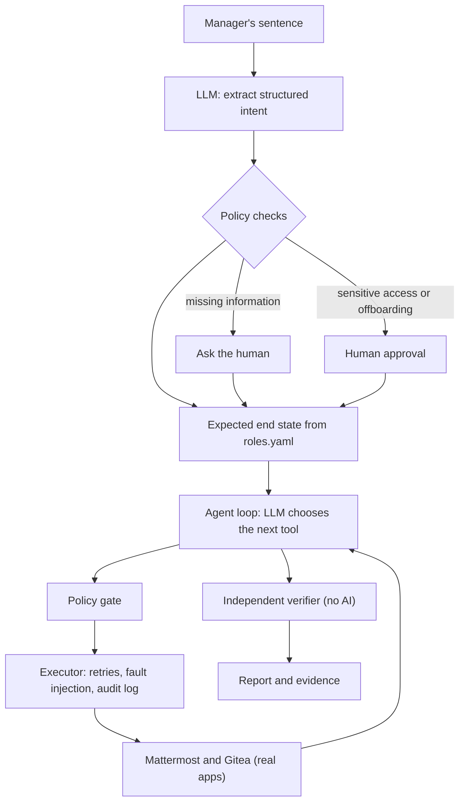

# Day-One Agent: Autonomous IT Onboarding with Ground-Truth Verification

**A policy-gated, independently verified autonomous agent for employee provisioning across Mattermost and Gitea.**

---

## Table of Contents

1. [Project Overview](#1-project-overview)
2. [Design Principles](#2-design-principles)
3. [Architecture](#3-architecture)
4. [Implementation Workflow](#4-implementation-workflow)
5. [Evaluation and Results](#5-evaluation-and-results)
6. [Repository Structure](#6-repository-structure)
7. [Setup and Usage](#7-setup-and-usage)
8. [Technologies and Tools](#8-technologies-and-tools)
9. [Key Design Decisions](#9-key-design-decisions)
10. [Assumptions](#10-assumptions)
11. [Known Limitations](#11-known-limitations)

---

## 1. Project Overview

This project is an autonomous AI agent that onboards and offboards employees across real applications. Instead of navigating several admin consoles, an administrator gives one sentence:

> "Priya Sharma joins Monday as a designer"
> "Rahul Verma left today"

The agent extracts the intent, applies the company's access rules, calls the REST APIs of **Mattermost** (team chat) and **Gitea** (code hosting), recovers from network failures without creating duplicates, and then verifies the result against the live services. The final status always comes from that independent verification, never from the model's own completion message.

| Assessment criterion | How it is addressed |
|---|---|
| Autonomy | The model turns one sentence into tool calls and adapts, for example when a username is taken |
| Execution | Real accounts, channel memberships and repository permissions are created or removed |
| Reliability | Bounded retries, idempotent tools, injected-fault tests, an audit log written before each action |
| Verification | An AI-free verifier proves what the person has and what they do not have |
| Generalization | A new company or role is a change to `config/roles.yaml`, not to the code |
| Engineering quality | Small single-purpose modules, typed models, 14 unit tests, a live benchmark, no agent framework |

---

## 2. Design Principles

LLM agents often report success even when an API call timed out or failed. In access control this causes silent failures: missing channels, orphaned accounts, or unintended privilege escalation. Text in a request can also try to manipulate the agent (prompt injection). The system therefore rests on three principles:

1. **Separation of reasoning and policy.** The model only parses the request and chooses tools. Access rules live in `config/roles.yaml` and are enforced by deterministic Python. Every tool call passes a policy gate, and no tool exists that can grant administrator rights.
2. **Human-in-the-loop safeguards.** Offboarding and requests for sensitive resources (such as the finance channel) pause for explicit human approval. Missing essential information, such as an unstated role, makes the agent ask instead of guess.
3. **Ground-truth verification without AI.** An independent verifier queries the real APIs and compares the actual state with the correct state computed from the rules.

---

## 3. Architecture



**Flow:** Understand, Check, Approve, Plan, Execute, Observe, Adapt, Verify, Report.

| Final status | Meaning |
|---|---|
| `VERIFIED` | The verifier confirmed the real state matches the policy |
| `FAILED_VERIFICATION` | The correct state was not reached; never reported as success |
| `NEEDS_HUMAN` | Essential information was missing and no usable answer was given |
| `REJECTED_BY_HUMAN` | A protected action was declined; nothing was changed |

---

## 4. Implementation Workflow

1. **Infrastructure.** Mattermost (port 8065) and Gitea (port 3000) run in Docker Compose, so the agent works against real open-source applications over authenticated REST calls.
2. **Policy.** `config/roles.yaml` lists the resources each role may access (a designer gets only the `design` channel and the `ui-kit` repository) and which resources are sensitive. Everything else is denied by default.
3. **Application clients.** `tools/apps.py` holds the REST clients for both apps. Secrets stay in a git-ignored `.env`; `.env.example` is the template.
4. **Policy gate.** `agent/policy.py` refuses out-of-policy requests and blocks tool calls for the wrong person, unapproved channels or repositories, wrong task type, or unapproved offboarding.
5. **Idempotent, fault-tolerant execution.** Create tools check for an existing account by email first, so a retry after a dropped connection never creates a duplicate. `agent/executor.py` logs each action to SQLite before running it, retries transient failures (HTTP 5xx, timeouts) a bounded number of times with increasing delays, and includes a fault injector for testing.
6. **Independent verifier.** `verify/verifier.py` checks that accounts exist and are active, that membership is correct, that access is **absent** for every unauthorized channel and repository, and that login works (or, when offboarding, is refused). Offboarding a person who has no account is reported as a failure.
7. **Model integration.** `agent/llm.py` is a provider-agnostic adapter (Gemini through an OpenAI-compatible endpoint, Claude, a deterministic mock for tests). I found and fixed a protocol incompatibility: multi-turn assistant tool calls must preserve Gemini's internal `thought_signature` attribute.
8. **Benchmark.** `scripts/evaluate.py` runs eight scenarios against the live apps and saves results to `reports/evaluation_results.json`: designer onboarding; developer onboarding; sensitive access approved; sensitive access denied; fault recovery and idempotency; prompt-injection resistance; negative offboarding (nonexistent user); and false-success / silent-failure detection.

---

## 5. Evaluation and Results

### 5.1 Autonomous onboarding

Onboarding of Maya Lin as a designer: the agent parsed the sentence, created the accounts, granted only the approved resources, and passed all 12 independent verification checks in 15.27 seconds.


### 5.2 Benchmark suite

The eight-scenario benchmark (one run per scenario) ran against the live local apps with `gemini-3.5-flash-lite` through the OpenAI-compatible provider.


### 5.3 Metrics

| Metric | Result | Target | Definition |
|---|---:|---:|---|
| Scenarios evaluated | 8 | Report | 8 distinct scenarios, 1 run each |
| Verified completion rate | 100.0% | Maximize | Tasks expected to succeed that passed independent verification |
| False-completion rate | 0.0% | 0.0% | Tasks marked verified despite unsupported or missing state |
| Duplicate account count | 0 | 0 | Extra accounts created during retries and fault recovery |
| Fault recovery rate | 100.0% | Maximize | Tasks recovering from injected timeouts (`fail_after_once`) |
| Unauthorized access grants | 0 | 0 | Sensitive or admin access granted without policy approval |
| Average latency | 39.46 s | Report | Mean runtime per task (median 44.05 s) |
| Average tool calls per task | 7.12 | Report | Mean tool invocations, including retries |

Scenarios 6 and 7 are negative tests that end in `FAILED_VERIFICATION` by design: they show the system refuses to claim success for a nonexistent user or a write that did not persist. The sample is small (eight scenarios, one run each, one machine, one model), so the figures indicate behavior but are not statistical guarantees.

### 5.4 Unit tests

`tests/test_agent.py` has 14 tests that run in about a second against in-memory fake apps and a mock model. They cover successful onboarding, missing role, username conflict, timeout after a successful write (no duplicate), retry after an early error, silent write failure caught by the verifier, an injected "make her admin" request, sensitive access approved and denied, offboarding approved and rejected, an unknown person, and the policy gate blocking out-of-policy calls.

---

## 6. Repository Structure

```
dayone-agent/
├── config/roles.yaml        Roles, managed resources, sensitive resources
├── agent/
│   ├── runtime.py           Central loop: intent, approvals, execution, verification, report
│   ├── policy.py            Role boundaries, approval rules, tool-call gate
│   ├── executor.py          Gate, retries, fault injection, audit logging
│   ├── llm.py               Model adapters: Gemini/OpenAI-compatible, Claude, mock
│   └── state.py, models.py, config.py, errors.py, reporting.py, factory.py
├── tools/
│   ├── apps.py              REST clients for Mattermost and Gitea
│   └── registry.py          Tool definitions and parameter schemas
├── verify/verifier.py       Independent verification (no AI)
├── scripts/                 seed.py, check_setup.py, evaluate.py
├── tests/                   fakes.py, test_agent.py (14 tests)
├── docker/docker-compose.yml
├── screenshots/             Images used in this README
├── run.py                   Command-line entry point
└── .env.example, requirements.txt
```

---

## 7. Setup and Usage

**Prerequisites:** Python 3.11+, Docker Desktop (WSL 2 on Windows), and a model API key (the mock model needs none).

```powershell
# 1. Clone and create the environment
git clone https://github.com/<your-username>/dayone-agent.git
cd dayone-agent
python -m venv venv
venv\Scripts\activate          # macOS/Linux: source venv/bin/activate
pip install -r requirements.txt

# 2. Start Mattermost (http://localhost:8065) and Gitea (http://localhost:3000)
docker compose -f docker/docker-compose.yml up -d

# 3. Configure settings
copy .env.example .env         # macOS/Linux: cp .env.example .env
```

Create the Gitea administrator and token, then put the token in `GITEA_TOKEN` in `.env` and set the model variables (`LLM_PROVIDER`, `OPENAI_API_KEY`, `OPENAI_BASE_URL`, `OPENAI_MODEL`). Never commit `.env`.

```powershell
docker exec -u git dayone-gitea gitea admin user create --admin --username dayone-admin --password "Admin-Pass-12345!" --email admin@example.test --must-change-password=false
docker exec -u git dayone-gitea gitea admin user generate-access-token --username dayone-admin --token-name dayone --scopes all
```

```powershell
# 4. Seed the apps and test every connection
python -m scripts.seed
python -m scripts.check_setup

# 5. Run the agent
python run.py "Priya Sharma joins Monday as a designer"
python run.py "Rahul Verma left today"        # asks for approval
python run.py "Aarav Patel joins Monday as a developer" --faults mm_create_user=fail_after_once

# 6. Tests and benchmark
python -m pytest tests/ -v
python -m scripts.evaluate
```

If `seed` cannot create the Mattermost administrator, open http://localhost:8065, sign up with the email and password from `.env`, and run it again. Each run prints the actions, the PASS/FAIL checks and the final status, and saves a JSON report in `reports/`.

---

## 8. Technologies and Tools

- **AI Coding Tools & Assistants:** Antigravity IDE (used as an AI pair-programmer for scaffolding boilerplate, syntax generation, and API protocol debugging).
- **LLM Runtime Models:** Google Gemini (`gemini-3.5-flash-lite`) via OpenAI-compatible endpoints.
- **Libraries & Frameworks:** Python 3.12, `pydantic` (schema validation), `httpx` (REST clients), `pyyaml`, `pytest`.
- **Infrastructure:** Docker Desktop (self-hosted local Mattermost & Gitea containers).
- **Data:** All data is synthetic. No real credentials, company data, or third-party systems are used.

---

## 9. Key Design Decisions

- **Policy in code, not in the prompt.** A prompt can be argued with; a gate cannot. No admin-granting tool exists.
- **The verifier decides the status.** The agent's own summary is shown for context but never used to decide success.
- **Idempotent tools keyed on email.** Checking before creating makes retries safe when a call succeeds on the server but times out for the client.
- **Verify absence as well as presence.** Most access problems are people having too much access, so every governed channel and repository is checked.
- **Audit log before action, one bounded repair round.** A failure mid-action leaves a trace, and a failed verification gets one more attempt before the task is reported as failed.
- **No agent framework.** A short, readable loop is easier to test, debug and explain.

---

## 10. Assumptions

- One Mattermost team and a fixed set of managed channels and repositories, defined in `config/roles.yaml`.
- An email of the form `first.last@<domain>` uniquely identifies a person.
- Offboarding means deactivating accounts and removing repository access, not deleting data.
- Demo accounts share one synthetic password; real deployments would use single sign-on.

---

## 11. Known Limitations

- The benchmark is a small sample (eight scenarios, one run each); the metrics are indicative, not statistically conclusive.
- Display names are not independently verified. In the onboarding run above, the audit log shows an incomplete last name passed to Mattermost and a first-name-only full name passed to Gitea; the verifier checks accounts, access and login, so it did not flag this.
- The verifier shares client code with the tools, so a bug in a client method could affect both.
- No crash recovery: an interrupted task is not resumed automatically.
- Only two applications and three roles, through REST APIs; there is no browser (UI) fallback.
- Mattermost runs from its all-in-one test image, and approval is a terminal prompt without user identities.
- Latency (about 39 seconds per task) is dominated by model calls and has not been optimized.
